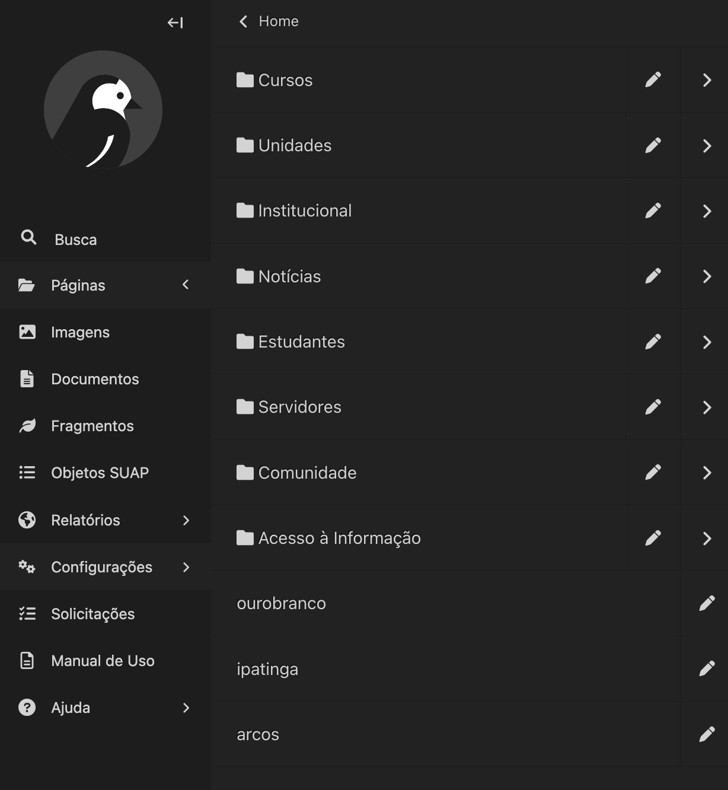
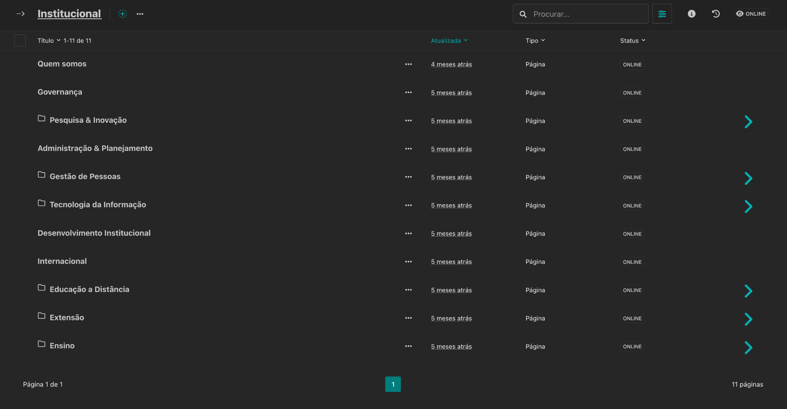
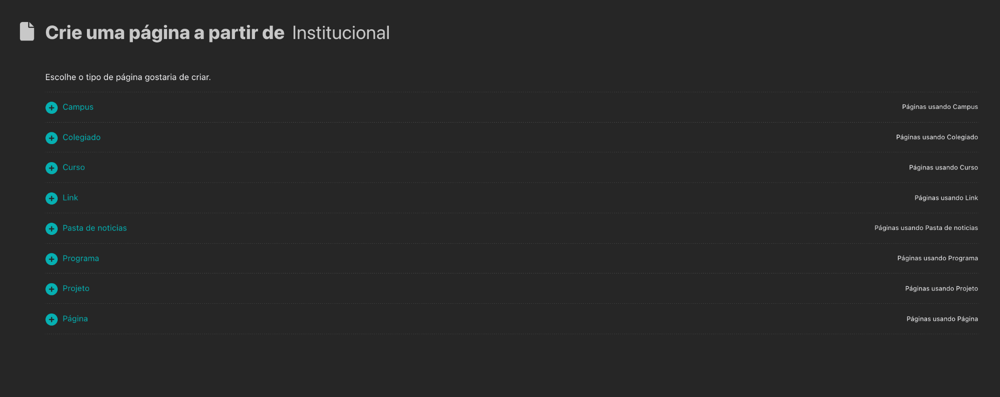
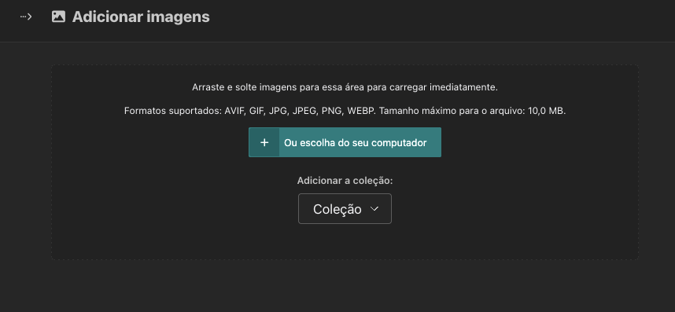
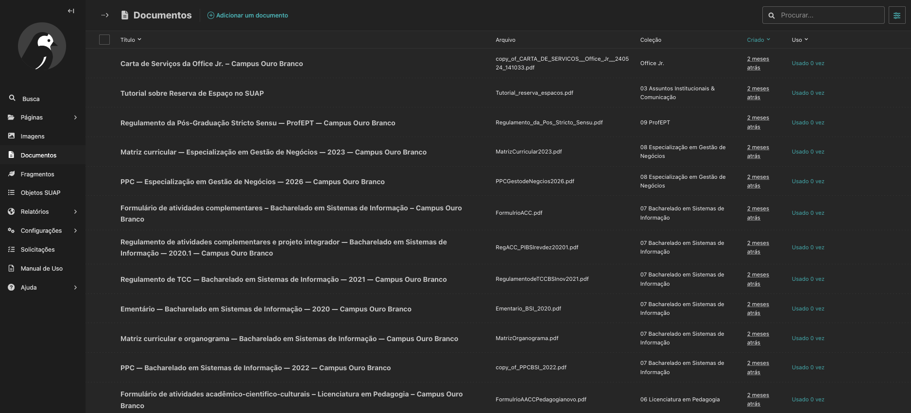
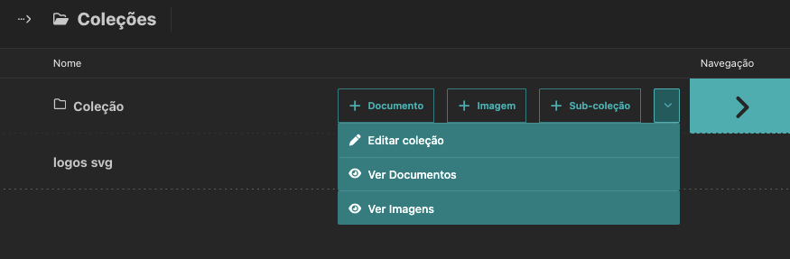
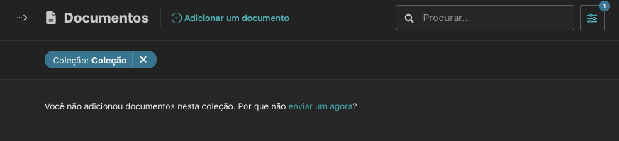
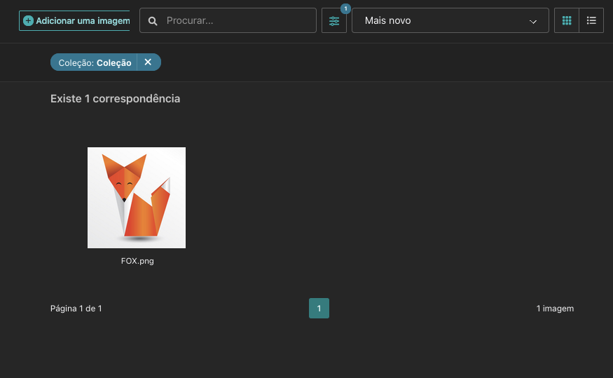
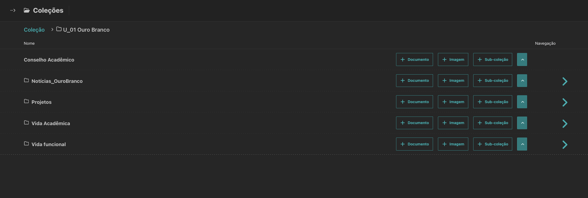
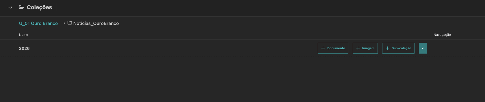

# Roteiro de condução — Treinamento Portal IFMG

**16/10/2026** · [Slides](./index.html) · [Prática](./pratica.html) · [Capturas pendentes](./CAPTURAS-WAGTAIL.md)

Este roteiro é um **apoio para apresentação oral**, não substitui os procedimentos canônicos do Guia do Portal nem permite executar tarefas no Wagtail sem autorização. As três capturas de navegação e escolha do tipo abaixo são da homologação IFMG em 20/10/2026. As demais capturas reaproveitadas continuam sendo referências do guia a conferir.

## Ideia central

**A arquitetura define onde a informação será encontrada; o fluxo editorial garante que ela seja preparada, revisada e publicada.**

A aula acompanha dois exemplos complementares: alguém procurando a **política de cotas** e a equipe preparando uma **página institucional da Biblioteca**. Para a Biblioteca, serviços, contatos, horários e documentos são ilustrativos e precisam de validação da área responsável.

## Abertura — cinco telas, incluindo a capa

| Tela | O que demonstrar | Transição para a próxima tela |
| --- | --- | --- |
| Capa | Há uma parte comum e trilhas por perfil. É possível saltar para cada trilha pelo índice. | Antes de editar, precisamos entender como a informação é encontrada. |
| Grafo anterior | O desenho representa páginas e relações mapeadas no portal anterior, cuja navegação refletia a estrutura institucional; **não é uma nota de desempenho**. | Como os públicos encontrariam suas informações? |
| Reitoria | Ler as **cinco entradas da Home**, agora junto ao grafo: Institucional, Estudantes, Servidores, Comunidade e Acesso à Informação. | E como essa lógica se aplica aos campi? |
| Campi | Ler as **sete entradas** do modelo e destacar como **fixas** Cursos, Processos seletivos e Eventos. As demais organizam informações locais. | Vamos seguir uma necessidade concreta. |
| Cotas | Percorrer **Home → Estudantes → Como ingressar no IFMG → Reserva de Vagas (Cotas)**. Este exemplo tem três cliques, não todos os assuntos. | Encontrar e produzir uma página são tarefas diferentes. |

**Limite da comparação:** os grafos do portal anterior, da Reitoria e dos campi têm **coberturas diferentes**. Não comparar quantidade de nós ou relações como prova automática de melhora. O mapa dos campi é um modelo, não uma garantia de publicação integral.

## Parte comum — as três estruturas

- **Páginas:** aparecem na árvore de navegação do site.
- **Blocos:** organizam conteúdo dentro da página.
- **Coleções:** armazenam e permitem encontrar documentos e imagens.

O Editor prepara, o Moderador revisa e decide, e o Administrador configura condições de acesso; sempre respeitando permissões. A IA auxilia a consultar o guia e preparar textos, não aprova nem publica.

## Editor — seis etapas da página da Biblioteca

| Etapa | Questão orientadora | Demonstração |
| --- | --- | --- |
| 01 Localizar | Estou na página-pai correta? | Árvore do Wagtail e tipo **Página**. |
| 02 Preparar | O que a pessoa precisa saber? | Serviços, horários, contato e metadados validados com o setor. |
| 03 Montar conteúdo | Qual bloco resolve essa necessidade? | Texto, Links, Link único, Cards e Tabela; não confundir com **Link** (tipo de página). |
| 04 Usar arquivos | Onde guardar e onde exibir? | **Documentos/Imagens** armazenam; o **bloco Coleção** exibe, com opção Recursivo para subcoleções. |
| 05 Busca e menus | A pessoa consegue encontrar a página? | **Promover** versus **Exibição do menu interno**. |
| 06 Revisar e enviar | Está pronto para a moderação? | Salvar, pré-visualizar em diferentes dispositivos, enviar para moderação. Enviar **não publica**. |

Não ensinar a criação de notícias como ação do Editor. No fluxo institucional, **notícias são produzidas por jornalistas, com perfil mínimo Moderador**.

### Localizar e criar uma subpágina — homologação de 20/10/2026

1. Clique em **Páginas** para abrir o menu lateral. Use a **seta** para expandir a árvore de **Home**. Clicar no **nome ou ícone da pasta** abre a listagem de subpáginas; o **lápis** edita a própria página; a **seta** expande a árvore lateral.

*Captura real da homologação: observe os controles diferentes para navegar, expandir e editar.*

2. Clique no nome ou pasta **Institucional** para abrir suas subpáginas. Para criar uma subpágina, clique no **ícone + próximo ao título Institucional**, no topo da listagem.

*Captura real da homologação: o + ao lado do título cria uma página dentro da página-pai aberta.*

3. Após clicar no +, a tela **Crie uma página a partir de Institucional** oferece **Campus, Colegiado, Curso, Link, Pasta de notícias, Programa, Projeto e Página**. Para uma página institucional comum, escolha **Página**. Essa lista foi observada em Institucional; não presume opções idênticas em outros locais ou perfis.

*Captura real da homologação: Página é a última opção; Link é um tipo de página, diferente de blocos de links.*

Use somente a página-pai autorizada para seu perfil. Se a ação não estiver disponível, solicite a conferência de acesso à equipe administradora. O exemplo Biblioteca continua ilustrativo; estas capturas não comprovam uma página de Biblioteca publicada.

## Moderador — correção e decisão

Continue com a mesma página da Biblioteca: está faltando o horário confirmado de atendimento às sextas-feiras. Uma boa devolução identifica o trecho, o dado a confirmar e o resultado esperado. Depois de corrigido, o Moderador verifica a mesma página e registra sua decisão.

A distribuição de notícias (Copiar, Alias e Linkar em outra pasta) é um **exemplo separado do trabalho dos jornalistas**. Diferenciar aprovar, publicar, agendar e despublicar.

**Ao apresentar os slides de revisão:** a primeira captura indica onde o Moderador encontra as solicitações; a segunda mostra a pré-visualização. O Status é outra etapa, que responde quando o conteúdo fica público. Não fazer publicação real durante a exposição. A mudança de horários da Biblioteca é um exemplo didático, não uma atualização confirmada de um campus.

### Localizar ou adicionar imagens e documentos

**Imagens** e **Documentos** mostram os arquivos acessíveis ao perfil. Use a busca ou o botão de filtros para localizar o que já existe. O responsável confirmou filtros por **coleção** e **tag**; a captura recebida mostra o botão, mas não o painel de filtros aberto.

Para incluir um arquivo, **Adicionar uma imagem** ou **Adicionar um documento** leva às coleções, conforme demonstração relatada pelo responsável. Na tela de coleções, navegue até o destino adequado e clique em **Documento** ou **Imagem** nessa coleção para iniciar o cadastro. A escolha do destino ocorre nesse percurso; não depende de um seletor dentro do formulário.

Como caminho preferido pelo responsável, quem tiver acesso pode abrir **Configurações → Coleções**, navegar até a coleção da unidade/finalidade/ano e usar **Imagem** ou **Documento** na própria linha. Isso permite começar pelo destino, evitando percorrer primeiro a listagem geral. Se Configurações ou a ação não estiver disponível, use o caminho permitido ao seu perfil ou confirme o acesso com a administração. Essa orientação não exige criar uma coleção nova.

A captura da listagem de Imagens foi anonimizada por recorte inferior autorizado, preservando busca, botão de filtros e Adicionar uma imagem. Está no slide `editor-imagens`, com o cadastro W10b. Para encontrar uma imagem já cadastrada, procure pelo nome ou por tag, use os filtros ou navegue pela coleção conhecida, conforme orientação do responsável. O painel de filtros não está aberto nesta captura.

*Homologação IFMG: confira a coleção e arraste ou escolha o arquivo; isso inicia o carregamento imediatamente. Esta tela de envio permanece no roteiro após a listagem ocupar seu lugar no slide.*

### Cadastrar imagens com descrição para acessibilidade

As capturas W10a (neste roteiro) e W10b (no slide `editor-imagens`) mostram o envio e o cadastro com **Título**, **Descrição**, **Coleção** e **Tags**. Confira a coleção antes de arrastar ou escolher o arquivo: o carregamento começa imediatamente. O título automático é apenas um ponto de partida e precisa ser substituído por um nome claro.

A **Descrição** comunica a informação da imagem para quem não consegue vê-la. Use o prompt já existente na seção **Para descrever uma imagem e avaliar se precisa de legenda** do [procedimento de apoio com IA](../04%20-%20Governança%20%26%20Manuais/guia-do-portal/00%20-%20Comece%20aqui/03%20-%20Como%20usar%20uma%20IA%20como%20apoio%20para%20trabalhar%20com%20este%20guia.md). Forneça a imagem e seu contexto, revise a proposta e não aceite detalhes inventados. Descrição e legenda têm funções diferentes; confira o texto alternativo no contexto em que a imagem será inserida. A captura mostra o aviso de descrição ausente, não um cadastro pronto para servir de modelo final.

### Cadastrar o documento após escolher a coleção

A coleção é definida no percurso anterior e aparece no cadastro. Confira **Adicionar a coleção** antes de arrastar o arquivo ou usar **Ou escolha do seu computador**: a tela avisa que isso envia imediatamente. Após o envio, revise **Título**, confirme **Coleção**, acrescente **Tags** e use **Atualizar**. A captura mostra um título derivado do arquivo, ainda não adequado como exemplo final.

Siga a regra do manual: título que explique documento, público e período quando necessário, por extenso e com espaços; para documentos de curso, **tipo + nome completo do curso + campus**, com ano/período/versão disponível. Consulte o [procedimento de adicionar ou atualizar documentos](../04%20-%20Governança%20%26%20Manuais/guia-do-portal/04%20-%20Sou%20editor/13%20-%20Sou%20editor%20e%20quero%20adicionar%20ou%20atualizar%20um%20documento.md) para exemplos e tags. As duas telas reais estão no slide de documentos.

*Referência real de acesso à listagem, preservada no roteiro; o slide agora apresenta a sequência de cadastro W09a/W09b.*

### Ver os arquivos de uma coleção

Na linha da coleção, abra a **seta do menu de ações junto a Sub-coleção**. Ela é diferente da seta à direita que entra no próximo nível. Escolha **Ver Documentos** ou **Ver Imagens**.

*Homologação IFMG: o menu de ações permite consultar os arquivos da coleção sem alterar sua estrutura.*

Em **Ver Documentos**, confira o filtro **Coleção: Coleção**. Neste exemplo, a listagem informa que não foram adicionados documentos nessa coleção; isso não comprova ausência de documentos em outras coleções ou níveis.

*Homologação IFMG: o filtro identifica o destino consultado e a mensagem informa o resultado dessa consulta.*

Em **Ver Imagens**, o mesmo filtro identifica a coleção consultada. Neste exemplo há uma correspondência, **FOX.png**. Use a busca dentro da listagem conforme necessário.

*Homologação IFMG: resultado da consulta de imagens da coleção demonstrada, sem presumir o conteúdo de outros destinos.*

Esse procedimento consulta o acervo no painel. **W11 trata de outra tarefa:** inserir o bloco Coleção no conteúdo de uma página para exibir arquivos, com as opções Recursivo, Mostrar imagens e Mostrar documentos. As três capturas acima não mostram esse bloco.

### Encontrar arquivos de notícias de um campus

A estrutura real de Ouro Branco confirma o caminho **Coleção → U_01 Ouro Branco → Notícias_OuroBranco → 2026**. Use a seta à direita para entrar no próximo nível e confira o caminho no topo. Não confunda esse destino com **Coleção → Notícias → 2026**, que pertence à coleção geral.

*Homologação IFMG, 20/10/2026: dentro de U_01 Ouro Branco, entre em Notícias_OuroBranco para localizar os arquivos de notícias do campus.*

*Homologação IFMG, 20/10/2026: escolha o ano dentro da coleção de notícias do campus. A imagem comprova 2026; a continuidade por anos foi confirmada pelo responsável.*

Essa é uma árvore de coleções de arquivos, diferente da árvore de páginas. O acesso e as ações disponíveis dependem das permissões. Se faltar o destino adequado, confirme com a administração antes de criar ou alterar coleções. A estrutura de outros campi precisa ser conferida no respectivo escopo.

## Administrador — configuração e limites

Explicar que **permissão de página não concede permissão de coleção**. Configurar os grupos apenas para o escopo necessário. Não renomear coleções por conta própria nem tentar resolver erros excluindo/recriando; registrar e encaminhar à manutenção técnica.

**Ao apresentar as permissões:** destaque que o esquema dos dois acessos é conceitual, não uma tela do Wagtail. Mostre a referência do menu Configurações e da opção Adicionar coleção, mas não execute operações administrativas. O alerta sobre renomeação continua na tela própria.

**Dica para apresentação presencial:** nas capturas existentes do Wagtail, use **Ampliar captura** para mostrar campos ou ações que estejam pequenos. O detalhe abre sobre o slide (inclusive em tela cheia) e fecha pelo botão ou por **Esc**. Enquanto estiver aberto, as setas não avançam a apresentação. As imagens são **referências do guia**; a ampliação não as torna capturas recentes da homologação e não recupera nitidez ausente no original.

## Acompanhamento e pendências

As [atividades individuais](./pratica.html) continuam fora dos slides. Para ações reais, consultar o Guia do Portal. A substituição das capturas existentes pelas imagens da homologação ocorre conforme o [checklist W01–W24](./CAPTURAS-WAGTAIL.md), após autorização e revisão de privacidade.

**QA:** deck atual com **42 telas**; o teste automatizado cobre dimensões, recursos e navegação. A legibilidade de campos pequenos em projeção e as capturas atuais da homologação seguem como pendências.
